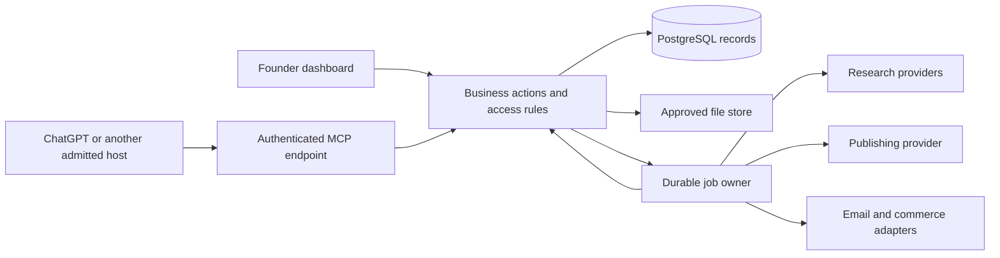

# A business operating stack with an owned application and optional services

TL;DR: Build one application for shared CRM, content, asset and decision workflows on a reusable backend; connect metered research, automation and publishing services through narrow adapters, and package a customer-owned installation after the first complete workflow works.

Research date: 11 October 2026. Status: proposed architecture, not implemented or independently approved. Prices and licenses need rechecking at the pinned implementation revision. This reusable blueprint does not change an existing company's accepted architecture or record ownership.

## The useful job

A solo founder should be able to research a prospective company, retain the evidence, prepare a professional follow-up, reuse an approved asset in content, publish after approval and see which effort produced a qualified opportunity. The founder should also be able to export the records, repair a failed step and understand the cost.

The product hypothesis is that a connected workflow across those jobs is worth owning. A generic CRM subscription replacement has a different investment case. Validate both against the same useful outcome before claiming savings or a competitive advantage.

## Proposed decision and serious alternatives

Start with Next.js and Payload for new shared workflows, PostgreSQL for relational records, the company's approved object store for files, and a small business-action API. The human dashboard, worker and MCP adapter use that API and the same collection access rules. Keep modules in one application initially. Separate a service when its runtime or independent ownership requires it.

[Payload's core](https://payloadcms.com/docs/getting-started/what-is-payload) provides an admin interface, schema/migrations, authentication, access control, uploads and REST/GraphQL interfaces. Its [core license is MIT](https://github.com/payloadcms/payload/blob/main/LICENSE.md), allowing commercial reuse with the required notice. Evaluate enterprise additions separately. This makes it a plausible foundation; CRM features and a complete asset lifecycle still require our implementation.

| Route | Choose it when | Cost and implementation consequence |
|---|---|---|
| Payload with our focused CRM, CMS and asset modules | A small company needs shared records and a reusable cross-module product | One application and fewer synchronization paths; we own the CRM behavior and its upkeep |
| Twenty for CRM, plus our content/asset application | Mature CRM behavior is needed sooner than we can implement it well | Extra deployment and integration; let Twenty own its CRM records and use its APIs |
| Existing Notion/Git records plus narrow automation | Few active relationships, mostly manual work and little product engineering capacity | Low migration risk; the workflow may remain useful without a new application |
| HubSpot or Attio plus our proprietary workflow | Capture, sales teamwork or a broader suite earns its total cost | Provider owns standard CRM operations; our application adds the differentiated workflow |

Twenty is the serious OSS CRM alternative. Its [Docker deployment](https://docs.twenty.com/developers/self-host/capabilities/docker-compose) includes a server/worker and persistent storage responsibilities. Keep that stack on a suitable container host, with the Next.js experience on Vercel if desired. A dashboard template cannot turn a container application into a serverless service.

[Twenty's license](https://github.com/twentyhq/twenty/blob/main/LICENSE) includes AGPL, marked commercial files and MIT packages. Its application exception permits proprietary applications using published interfaces without incorporating or modifying Twenty source. Modifying Twenty itself remains subject to the relevant license. Retain a pinned license bill of materials and obtain distribution review for the actual commercial bundle.

## Component choices

| Layer | First choice | What we engineer or preserve |
|---|---|---|
| Founder interface | Existing accepted Next.js interface; v0 for a bounded screen or prototype | Useful views, loading/error behavior, keyboard/mobile access and clear approvals |
| CMS and administration | Payload for new workloads | Collection schemas, editorial permissions, drafts, revisions and publication rules |
| Focused CRM | Our relational collections; Twenty as an optional CRM authority | Companies, people, opportunities, activities, follow-up dates, source evidence and deduplication |
| Digital asset management | Existing metadata/approval authority plus approved object storage | Rights, provenance, versions, renditions, review, placement and takedown |
| Data | PostgreSQL; managed Supabase where already accepted | Domain migrations, identity mapping, indexes, transactions, export and restoration |
| Research | Firecrawl for public pages; Apify for a selected specialist Actor | Evidence cache, structured validation, freshness, bounded waterfall and accepted-result cost |
| Own crawler | Crawlee when repeated jobs justify operation | Site-specific extraction, selector maintenance, browser/proxy budgets and receipts |
| Automation | Reuse the existing n8n/workflow owner | Fixed job definitions, error recovery and adapter calls; one durable owner per workflow |
| Social publishing | Existing Postiz route, or its hosted service if total cost wins | Brand/content approvals and exact publication receipts; scheduler remains execution authority |
| Email and meetings | Existing mailbox/calendar and Communications OS adapters | Follow-up preparation and consent; original messages remain with the provider |
| Revenue | Existing payment, accounting and tax systems | Products, entitlements and operational projections with reconciled provider receipts |
| Knowledge and IT decisions | Existing reviewed Git decision home and human knowledge workspace | Current-source research, cost scenarios, decision rationale and review triggers |
| Operational visibility | Existing telemetry plus domain job/usage records | Failed jobs, connection expiry, repair, attributable spend and useful outcomes |

Projects, tasks and simple support cases can use the same shared records once those workloads are proven. Payroll, tax calculations, payment custody, mailbox delivery, arbitrary video rendering and full enterprise support are separate capabilities. The initial stack does not establish feature parity across them.

Preserve an existing site's accepted Git/MDX content source. Introduce Payload authoring for a new or deliberately migrated workload; avoid two writable sources for the same content. Likewise, do not copy an adopted CRM's internal tables into our own editable CRM authority. Keep external IDs and read projections with a stated owner.

For the estate, accepted media-fabric-v2 remains in force: Supabase asset metadata/approval, Drive private masters/review/recovery, and Vercel media delivery defaults. A Payload upload collection may hold an upload proposal or reference the accepted asset ID. It must not become a second approval authority. A new customer's installation chooses its own explicit owners.

## Deployment boundaries

[Payload can run with Next.js on Vercel](https://payloadcms.com/docs/production/deployment). The database, durable files and email delivery remain external resources. [Its storage adapters](https://payloadcms.com/docs/upload/storage-adapters) support Vercel Blob and S3-compatible alternatives. Large uploads need the supported direct-client path; access to private files still needs a verified authorized delivery design.

Run n8n and adopted Docker services on a suitable existing worker/container host. Run browsers, long crawls and media work in the admitted job runtime or provider. Do not hold an HTTP request open for a long enrichment job. Return a job ID, persist its status, and provide cancellation and progress.

There are two sensible deployment offers:

1. Customer-owned managed installation: customer's Vercel project, managed PostgreSQL, object storage and provider accounts. Easier operation, predictable separation of company data and keys, and metered infrastructure.
2. Customer-owned Linux/Docker installation: application, database and selected workers on a suitable host with object storage and off-host backup. More infrastructure control; the customer or an explicitly contracted operator owns upgrades, recovery and capacity.

For our estate, reuse the shared tool plane, identity, secrets and existing admitted services. A customer-facing MCP endpoint belongs to the application capability; it does not justify another local gateway or globally enabled servers for every agent. A many-customer hosted SaaS would need a separate tenancy, billing, support and data-custody decision.

## Shared data model and state

These are proposed logical records, not installed database tables. Names can map to existing schemas.

| Record | Essential fields or links | Authority rule |
|---|---|---|
| Company/person | Stable ID, company scope, professional fields, external IDs | Research proposes updates; merge explicitly preserves current values and provenance |
| Evidence | URL/provider, retrieved time, content hash, retention class, supported fields | Scraped text is untrusted data; it cannot grant authority or execute instructions |
| Opportunity/activity | Company/person links, owner, stage, due date, source | A draft follow-up does not imply a message was sent or a last-contact date changed |
| Asset/version | Checksum, master reference, rights, generation provenance, rendition links | Approval binds exact bytes/version; changed content needs new review |
| Content revision | Brand, channel intent, source links, approved asset IDs, revision | Published state requires a provider receipt for the approved revision |
| Approval | Target ID/revision/hash, permitted action, approver, expiry | A different version or revoked permission invalidates execution |
| Job | Requested action, owner, input hash, idempotency key, status, attempt receipts | One durable owner, bounded retries, resumable stages and uncertain-result handling |
| Usage | Job, provider/model, units, price basis, retries, operator repair time | Record estimated and actual cost separately; missing provider cost stays unknown |
| Decision/experiment | Problem, options, dated evidence, costs, rationale, status, owner | Proposed advice becomes accepted only through the company's review path |

Content state: `draft -> in_review -> approved -> scheduled -> published`, with explicit `rejected`, `failed`, `outcome_unknown` and `withdrawn` paths. Job state: `queued -> running -> waiting_approval -> succeeded`, with `failed`, `cancelled` and `outcome_unknown`. Domain code defines allowed transitions and keeps receipts. A scheduler timeout after submission stays uncertain until reconciled with the provider; a retry must not create duplicate posts.

## A first end-to-end workflow

Use a founder-approved public company URL and a permitted professional CRM record. Begin in draft mode, then obtain actual publication authorization for the last step.

1. Check the URL, source permission, cache freshness and job budget. Reject private-network targets and fetches outside the allowed scope.
2. Retrieve the public page through one selected provider. Retain its source/time/hash and an allowed evidence copy. Validate extracted fields; missing facts stay unknown.
3. Match the company by stable identifiers/domain and propose a CRM update. Show supporting evidence, differences and conflicts before applying permitted changes.
4. Prepare a useful professional follow-up and a content draft, both linked to the same evidence. Record them as drafts. Human contact facts come from approved records.
5. Select an approved asset with usable rights. If a new asset is generated, retain the exact generation provenance, source/version and applicable ledgers before approval.
6. Review the content and asset version. Save a version-bound approval, then submit once to the publishing provider through the domain action.
7. Reconcile publication or an uncertain result and retain the provider post ID. A later permitted signup or qualified conversation links back to the content with attribution uncertainty visible.
8. Show useful output, research/model/hosting usage and repair effort. Export the complete permitted record/evidence set and demonstrate recovery from an interrupted job.

This pilot exercises CRM, CMS, DAM, research, MCP and publishing together. Separate a smaller research-to-CRM pilot if publication access is unavailable; leave the publication proof open.

## MCP connection and actions

Expose one authenticated HTTPS `/mcp` endpoint for the application, using a supported MCP SDK and transport. [OpenAI's server/UI quickstart](https://developers.openai.com/plugins/build/app-quickstart) covers the connection pattern; [its authentication guide](https://developers.openai.com/plugins/build/auth) expects an OAuth 2.1 flow for authenticated MCP servers. Reuse a suitable established identity provider and verify its current discovery/client-registration support. A working application login alone is not an OAuth MCP connection.

| Example tool | Scope and behavior |
|---|---|
| `crm_search` | Read only professional records permitted for this principal; bounded pagination |
| `research_company` | Create a bounded evidence job with provider/page caps, then return its ID |
| `crm_propose_update` | Prepare a versioned diff with evidence; no automatic authority promotion |
| `crm_apply_update` | Apply allowed fields with expected version, identity and idempotency key |
| `assets_find_approved` | Return approved versions with rights and scoped delivery references |
| `content_prepare` | Create an editable unapproved revision with source/asset links |
| `content_request_publication` | Require the exact approved revision and an authorized execution grant |
| `jobs_get` / `jobs_cancel` | Read or cancel only permitted jobs, preserving attempts and uncertainty |
| `decisions_propose` | Save researched proposed advice to the existing decision review path |

These tools should be ordinary application actions underneath. Hooks and collection rules enforce protected fields and state transitions for generated REST/admin routes as well. An agent cannot bypass those rules through another interface.

A material Payload integration detail: [Local API calls bypass access control by default](https://payloadcms.com/docs/local-api/overview). User/agent operations must use an authenticated principal with `overrideAccess: false`; enforce document locks or explicit expected-version checks as appropriate. Separate privileged system tasks from delegated user operations and test both allowed and denied behavior.

Connection steps: deploy the server and auth metadata; register/install the endpoint in each supported host; sign in and grant company/action scopes; perform an allowed read, a denied cross-scope call, a safe versioned draft write and revocation. ChatGPT cloud and local Codex are separate clients. Host plan/workspace policy, unattended credentials and supported tool capabilities require actual verification. Tools may be discovered selectively so every agent does not receive every permission or tool definition.

Long work returns a durable job reference. Retry/resume, approvals, audit and budgets belong to the application/runtime. An MCP connection provides an interface; it does not by itself operate an unattended business.

## Research economics and quality

Use a bounded waterfall: valid cached evidence -> inexpensive permitted page retrieval -> Firecrawl when needed -> a selected Apify Actor or licensed data source for the missing field -> human review. Choose the next step only when its expected usable output justifies cost. Keep a page/actor cap and stop on budget exhaustion.

[Crawlee](https://crawlee.dev/) is an own-crawler option under [Apache 2.0](https://github.com/apify/crawlee/blob/master/LICENSE.md). Apify is a hosted platform with metered Actors, not a free OSS substitute. Its [current pricing](https://apify.com/pricing) lists Starter at $19/month plus usage, with $19 spend included. Selected Actor pricing, compute, storage/proxies and actual attempts need quoting.

[Firecrawl self-hosting](https://docs.firecrawl.dev/contributing/self-host) trades infrastructure control for operating responsibility and has capability differences from its cloud service. Its default stack supports core routes but omits the included advanced scraping engine and several cloud capabilities. Benchmark the exact sites and pinned version before treating self-hosting as an equal substitute.

Public web extraction can replace some company research and list-building work. Verified email/contact data, private sources, deliverability and specialist datasets may still require licensed providers. Compare accepted field accuracy, freshness, coverage and repair time; a scraped record is not automatically a qualified prospect.

## License boundary for automation and social publishing

n8n Community is source-available under its Sustainable Use License. Current [vendor guidance, updated 6 October 2026](https://support.n8n.io/article/can-i-use-your-license-for-my-use-case), permits fixed background workflows in a product when our organization controls the workflow logic, including customer-connected accounts. External users building/configuring workflows through UI, API, MCP or an agent require a commercial license; hosting/white-labeling n8n as a service also has restrictions.

The [current license FAQ](https://docs.n8n.io/n8n-community-license/community-license/license-faq) separately flags paid customer bundles as a case to confirm. A BYOK or customer-owned installation does not erase license obligations. For an initial proprietary product, own the business-action code and connect fixed approved workflows or a customer's existing n8n installation as an optional adapter. A sold automation builder needs its own verified license path or a suitably licensed alternative.

[Postiz source is AGPL](https://github.com/gitroomhq/postiz-app/blob/main/LICENSE). Keep source obligations/notices intact and review modifications/bundling. Its [hosted pricing](https://postiz.com/pricing) starts at $29/month for five channels, with API/MCP access included. Compare the existing self-hosted route's total cost before choosing hosted service or another deployment.

Pin component/template versions, licenses and notices in the product BOM. v0 generation, a deployment button, public source and a BYOK setup do not independently settle third-party commercial distribution rights.

## Cost model

Record provider quotes, assumptions, existing capacity and measured usage separately. [Vercel Pro](https://vercel.com/pricing) lists $20/month plus additional applicable usage/seats. [Supabase Pro](https://supabase.com/pricing) starts at $25/month; its calculator shows one Micro project offset by the included compute credit. Extra projects, compute/storage/egress and backup requirements change the bill.

An illustrative small-workload target for a new managed installation:

| Item | USD/month | Basis |
|---|---:|---|
| Vercel Pro, one developer | 20 | Published entry plan; usage beyond included amounts separate |
| Supabase Pro, one Micro project | 25 | Published plan/calculator; required capabilities must fit |
| One modest worker/orchestration host | 15 | Planning allowance, not a provider quote or capacity guarantee |
| Files/email/telemetry allowance | 10 | Assumption; price against retained GB, traffic and sends |
| Bounded research and model usage | 50 | Proposed spending envelope, subject to provider minimums/meters |
| Total target | 120 | Scenario, not an observed invoice or full-suite parity claim |

Hosted Postiz would add its quote; adopted Twenty may require more worker capacity. Development tools including v0, domains, mailbox/workspace, bookkeeping, taxes/VAT, payment fees, support, engineering and any license fees are outside this illustrative target. The complete company cost model adds them explicitly. Existing paid capacity may reduce incremental cash only after actual usage and headroom are verified.

Illustrative labor sensitivity: four maintenance hours/month valued at $75/hour add $300. A hypothetical 60-hour build adds $4,500 upfront; spread across 12 months it adds $375/month. With the $120 cash scenario, that is $795/month in first-year allocated cost. These are assumptions, not a project effort estimate. Compare them with the same useful workflow delivered by alternatives and count product reuse only after it is demonstrated.

[Clay's plans](https://university.clay.com/docs/workspace-administration-documentation) list Launch from $185/month and Growth from $495/month, with separate action/data meters. [HubSpot also has a free CRM](https://www.hubspot.com/products/crm), currently up to two users and 1,000 contacts; quote the required paid hubs, seats and contacts before calling a specific configuration expensive. A narrow owned stack can plausibly reduce several subscriptions, but replacing a free CRM alone cannot create subscription savings.

Savings controls: qualify first; reuse fetched evidence and approved assets; deduplicate before paid research; batch where supported; require provider budgets and maximum attempts; attribute usage to jobs; downgrade or retire subscriptions only after the replacement is accepted. Platform spend alerts are useful, but verify which services actually enforce a hard cap.

## Getting a template into production

Use the existing accepted product and its owner. Import a license-checked Payload/Next.js foundation or a bounded v0-generated interface into an owned branch, then bind it to real actions. An installable product needs the complete workflow, editable output and recovery.

For a new content-led installation, evaluate the official [Payload website template](https://github.com/payloadcms/payload/tree/main/templates/website). Its source includes users, posts, pages and media, with drafts/preview and scheduled publishing. Extend its real backend with the CRM/asset actions. For an existing accepted application, import only the needed configuration/components instead of replacing the whole application. Use v0 for the pipeline view, research review, asset browser or approval inbox after the data/actions are defined. Pin the selected template and inspect its access rules; the website template's public-content defaults must not expose CRM records or private assets.

1. Prove the matched workflow against the incumbent and Twenty where CRM depth matters. Retain actual evidence, operator repair time and costs.
2. Define one owner per domain record and workflow. Apply scoped identities, protected transitions, bounded jobs and explicit provider adapters.
3. Deploy a preview with an isolated database/project and permitted fixtures. Run production-like migrations and a restore, then test secrets, permissions, concurrency and uncertain provider outcomes.
4. Refine the real interface with the owning design/accessibility contract. Inspect desktop/mobile, keyboard focus, touch, reduced motion and interrupted transitions.
5. Obtain independent review at the exact revision and owner acceptance. Verify the authorized live path, receipts, cost limits and recovery before cutover.
6. Export data from the incumbent, reconcile IDs and counts, migrate in a controlled window, and retain a rollback path. Retire paid services only after replacement behavior and invoices support the change.

## Reusable commercial offer and company planner

Candidate product route: extend the existing Business OS/Pathfinder installation and reuse creator/content implementations whose current source passes inspection. Preserve customer-owned brand, data and keys. Packaging does not establish demand; compare against a founder assembling Payload/Twenty/n8n directly and a founder using SaaS.

The proposed deliverable includes working modules, documented API/MCP actions, install diagnostics, provider connection tests, import/export, backup/restore, migrations, a supported update path, scoped operation, license notices and useful worked examples. Updates must preserve customer-owned files and data; the existing harness-only update mechanism is not yet an application/database updater.

Customer profiles select only needed modules. Fixed capabilities can be invoked by agents through MCP, while a company-planning capability gathers constraints and dated official evidence, computes transparent cost scenarios, proposes an ADR, and generates a bounded implementation/pilot packet. The founder can revise or reject its recommendation and records that rationale.

Suggested files in each company's existing decision home: `decision.md`, `sources.json`, `costs.json`, `experiments.jsonl`, `migration.md` and `runbook.md`, grouped under the existing decision ID. They are proposed output names, not a new central registry. Retain exact inputs/source revisions, rejected trials, assumption changes and approval status. Human-facing projections show the accepted source revision.

## Verification and next gate

Before implementation acceptance, demonstrate: source-preserving extraction; unknown-field handling; duplicate matching; stale-edit rejection; denied company/action scopes; approval invalidation after edits; no duplicate effect after retries; uncertain-result reconciliation; token revocation; budget exhaustion; cancellation/resume; export and restored use.

Product acceptance additionally requires a founder completing the connected job with useful output and tolerable repair effort. Record the baseline, sample size and missing coverage. A cheaper bill, generated UI or passing structural checks alone does not establish that result.

This document's primary sources, price arithmetic and structure were checked by its maker. Independent provider review remains pending; earlier review-client authentication/access failures produced no verdict, and this new revision has no independent approval. No system described here was deployed or cut over in this research slice.

Generated by AI Architect · https://www.frankx.ai/ai-architect
