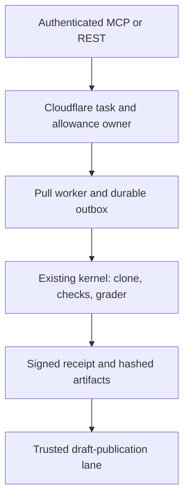

# Starlight execution service — bounded development candidate

The existing Starlight Kernel owns acceptance and signed receipts. This adapter adds authenticated task admission, durable Cloudflare coordination, a pull worker, restart-safe completion outbox and a draft-publication adapter. It does not introduce a second agent framework.

**Demonstrated:** a real estate source revision, deterministic repair of the lab portability bug, 97 passing protected checks plus two external skips, signed kernel receipt, actual workerd restart, duplicate submission and draft GitHub PR [384](https://github.com/frankxai/agentic-ops-hub/pull/384). This is an integration demonstration, not a frontier-model evaluation. Live maker execution remains refused until maker isolation and provider spending controls are available.

## Ownership



`cloudflare/` implements the first two layers; `worker.mjs` owns dispatch and its local journal; `kernel-adapter.mjs` reuses the operator-installed kernel; `publication.mjs` prepares a strictly internal publication packet and uses an injected GitHub API transport. Do not expose publication packets, acceptance commands, local paths, policy or contract creation over MCP.

Canonical architecture consulted: `frankxai/agentic-ops/registry/architecture_decisions.yaml` (persistent entity runtime, portable domain logic, one durable owner). This release stores only run-local state in the Durable Object; it does not move shared business truth into a new database. The production `starlight-cloud-worker` has containment annotations and is untouched.

## Reproduce

Use Node 24.19+ and Python 3.12. Install coordinator development dependencies with `npm ci --ignore-scripts` inside `cloudflare/`. The runtime Worker has no npm dependencies.

```sh
node fleet/execution/verify.mjs
```

For the full estate demonstration, obtain the existing kernel at **c69e582f61b25cbb92791aa8acedef0dfcf29b21**, make hub revision **9f5999f18b9e1ec6a181b70d8b2b3ce080ded11f** available in the source clone, and use a Python interpreter with **jsonschema 4.26.0**:

```sh
node fleet/execution/verify.mjs --demo \
  --kernel /absolute/starlight-kernel \
  --source /absolute/agentic-ops-hub \
  --python /absolute/venv/bin/python
```

The demo creates an isolated temporary source clone, kernel home, private worker journal and persisted local Cloudflare database. It prints a report path. It writes a draft-publication packet but does not contact GitHub. It never reads a real model key. `actual_cost_microusd:0` in this fixture means no inference was invoked; infrastructure cost is unmeasured, not zero.

## Worker configuration

Operator configuration is private JSON, passed as the single argument to `node fleet/execution/worker.mjs <config>`. Fields: `endpoint`, `presets`, `journal`, `worker_id`, `kernelRoot`, `kernelHome`, `kernelPolicy`, `artifactRoot`, and explicit `allowFixtures:true` for this demonstration. Set `EXECUTION_WORKER_TOKEN` in the worker environment. Neither worker nor client credentials belong in source or command arguments.

The separate preset registry is `{version:1,presets:[...]}`. Each preset pins `task_kind`, exact GitHub `repository`, full `revision`, immutable kernel `contract_id`, `max_seconds`, positive `max_allowance_microusd`, and `isolation`. Only the fixed `trusted-local-fixture` adapter is currently executable; `container` is recognized as a future activation boundary and refused. The fixture adapter additionally requires the exact checked-in maker/checker paths. Arbitrary shell adapters are not remote capabilities. The worker rejects nonempty prompts because the operator's immutable contract defines this release's task.

The pull worker runs one admitted task per invocation. There is no unattended daemon installed. Its journal stores claims and completion results before network completion; on restart, pending results are replayed, never makers. An interrupted started attempt becomes unknown usage and retains its remote allowance. Exclusive host/PID ownership prevents overlapping journal recovery. Foreign-host ownership requires operator reconciliation; this journal is not a distributed shared-filesystem lock.

Cancellation is polled; the process group is terminated on POSIX. The kernel clone is repository separation, not a security sandbox for hostile same-user code. Full model makers remain off. The adapter never gives maker processes coordinator, cloud or GitHub credentials.

## Publication and proof

`preparePublication()` rechecks kernel acceptance, source repository, immutable contract and receipt; it exports exact UTF-8 Git blobs. `publishDraft(packet, trustedApi)` verifies the base has not moved, requires an identical artifact tree, refuses differing branch content or parent lineage, and creates only a draft. The API transport and credentials belong to the trusted service lane. The actual demonstration PR was created through the authorized GitHub connector from this packet, not by an unattended worker with a GitHub token.

GitHub-created commit metadata changes its SHA. The kernel receipt remains bound to the local artifact SHA; tree equality establishes identical file content and is recorded separately. This is not a signature over the GitHub-created commit. `starlight.receipt.v1` is the kernel schema; do not relabel it as SIS `starlight.run-receipt.v1`.

Artifacts are local exports with bounded relative references. `get_artifacts` returns metadata, not hosted downloads. Public-key verification is implemented by the existing kernel. The coordinator trusts its worker credential and labels proof `worker-self-asserted`; actor labels are not independent identity attestation. The artifact release filter blocks common credential forms, not every possible secret.

## Release gates

| Gate | Current evidence |
|---|---|
| Authenticated HTTP/MCP and protocol client | Real workerd tests and official MCP SDK client |
| Atomic allowance, duplicate delivery, restart, cancel, unknown usage | Automated fault fixtures |
| Real estate repair and signed receipt | Deterministic local demonstration and draft 384 |
| Independent frontier-model evaluation | Not run; 0/12 model tasks, target remains 9/12 |
| Paid provider cap and actual usage ingestion | Not activated; local reservations are not provider caps |
| Container maker isolation | No Docker/Podman available; live makers refused |
| Cloudflare development deployment | Deployed and smoke-tested at starlight-execution-dev.frankxai.workers.dev; production untouched |
| ChatGPT connection | Five-tool server tested; no account connection installed |

The separate paid-launch patch stacks on routing PR 377; it closes prelaunch allowance admission and retains unknown usage. Do not count its reservation and the coordinator's reservation as separate provider spend. No monthly reset, billing, purchase or budget increase is introduced here.

## Rollback and pickup

The development worker is deployed with separate secret bindings and no inference binding. `live-smoke.mjs` uses the official MCP client over real HTTPS, then a local fixture worker calls the deployed claim/complete API. Pass `--credentials <private-json> --fixture-root <local-demo-output> --kernel <kernel-clone> --endpoint <development-url>`. The private JSON contains `client` and `worker` bearer tokens; it must never enter source or artifacts. No ChatGPT account connection has been installed. The local kernel fixture worker is not a hosted daemon.

Rollback: revoke client and worker secrets or disable the development route before changing state. Preserve unknown holds and signed artifacts; do not delete Durable Object storage or signing keys as a rollback shortcut. Never upload this candidate over the contained production worker. See `cloudflare/README.md` for HTTP contracts and development deployment instructions.

Next engineering gate: run the same immutable contract with a real isolated maker and independent vendor checker, reconcile provider-reported usage, then measure accepted-task cost. Only then extend the adapter to additional harnesses or activate unattended execution.
