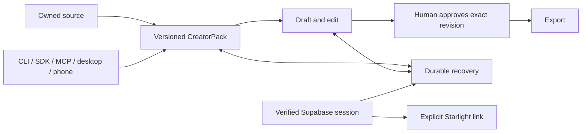

# Execution contract

Frank has resumed end-to-end execution. The native tracker still stores paused and has no resume operation; that stale field does not revoke his instruction. G2-G6 remain open. This updates the existing plan; prior plans, attempts and release receipts remain in Git and session history.

## Goal capsule

An expert brings sources they own or may use, produces work that preserves their argument and voice, edits it, approves an exact revision, exports it and resumes after interruption. GenCreator owns source rights, identity, evidence, approvals and durable state. Existing assistants and replaceable adapters supply generation. Community supports creators and informs development.

Accepted product: ADR-007/010 and CreatorPack. Frank confirmed Supabase sessions with explicit Starlight links, implemented by ADR-013/PR196. Linking preserves the canonical Starlight principal and tenant membership; it must not transfer permissions or subscriptions implicitly.

The first managed milestone is a verified creator journey. Configuration checks and READY deployment are supporting evidence and cannot close creator acceptance, native-app delivery or commercial goals.

Product source e705527 is now independently reviewed and published with a READY preview; readiness/configuration are supporting gates. See the latest session for exact checks, coverage follow-up, preserved failures and remaining release/activation dependencies.

## Current evidence and decisions

Refreshed 11 October:
- GenCreator main and READY production source: d01529702eef91188c35bc6cbdca6aa7074be9ec. Other owner's [PR203](https://github.com/frankxai/gencreator.ai/pull/203) added save beside drafts and source/recovery/export navigation. Reuse it.
- Portable CLI/plugin 0.5.3 and CI cost PR201/202 were released previously. Downloaded Windows consumer: 13 steps/three live calls; 22 public smoke checks. These receipts retain their earlier exact scope.
- Current public health and MCP discovery return 200; managed readiness is 503. Read-only probes do not prove authenticated use.
- Vercel CLI reports no variables in gencreator-ai, team starlight-intelligence, project prj_nIryRFHID247Sh0DEp2oH1T4amnO. Connector environment inspection returned 403; successful CLI fallback was used.
- Recommended database: existing EU Starlight Platform gfrfcqyprekhazzugdkr, eu-central-1, reviewed gencreator_companion schema. This is the lead's recommendation after “idk you suggest”, not founder approval of production SQL. Metadata finds public but neither GenCreator namespace.
- Inspected tools expose no secure privileged server-key retrieval or auth/SMTP/Clerk OIDC configuration. Publishable-key access is insufficient. No secrets were printed.
- Actions usage: $77.808568267, separate from Copilot. Frank approved only $5 extra and reported a $75 cap; actual budget scope/value is not API-verified. Hold new release jobs pending verified allowance. Preserve Stop usage and Copilot.
- PP held review at1460MB, then admitted one bounded review at7240MB/77% CPU;27 task runtimes and pause-new-swarms. Recheck admission. One shared cloud reviewer, focused tests and one automatic Git preview ran; no new persistent local worker. A lockfile-verified private esbuild binary recovered tests without editing shared dependencies.
- CSS hook repeats two unique findings. Main already contains PR194's narrow rule/value/file exceptions for the intentional edition-cover spine and selected-button underline. Preserve them; no CSS fix/new suppression needed. Earlier “no ignores” reporting was inaccurate.

## Goals and metrics

| Goal | Current state | Acceptance |
| --- | --- | --- |
| G0: release inputs | Refreshed for current lanes; estate coverage open | Exact source, guides/hashes, owners, protections, deployment and machine/cost admission. Unknown coverage remains unknown. |
| G1: portable release | Released with earlier source-bound receipts | Retain package integrity, source review, consumer recovery, normal candidate/main CI and domain evidence; refresh changed scopes. |
| G2: managed alpha | Open | Two real accounts pass login/membership, explicit link/cancel/retry/revoke, cross-tenant denial, idempotent save/readback, interrupted recovery, export and disconnect. Reviewed retention/delete respects sealed evidence. Every critical case passes; zero unauthorized access or lost authored work. |
| G3: valuable creation | Open | Consented expert receives useful newsletter/long form, social sequence and script/brief with sources, voice, rights and revision review. They edit and accept at least one artifact. Compare identical brief with native assistant plus Markdown/manual workflow; measure elapsed time, repair, total cost and creator judgment. |
| G4: clients/agents | Portable proof partial; managed open | Existing CLI/plugin, SDK, ADK and creator-MCP share the contract. Actual distributed cold install, native assistant use, scoped auth, version negotiation, cancel/restart and receiver import/edit/export preserve provenance/approvals. |
| G5: devices/memory | Open | Actual desktop and phone resume authenticated work. Selected existing native desktop/mobile implementations are installed and exercised. Tenant recall, conflict recovery and deletion/expiry pass. Responsive web alone cannot prove native apps. |
| G6: community/offer | Open | Consented onboarding, returns, support and real economics. Before checkout: entitlements, refunds/cancel, webhook retries, limits, entity/license/provider rights and offer review. No autonomous public publication. |
| O1: agent order | Local guard installed; adoption incomplete | Per-harness source loading plus fresh native behavior and actual denial tests. Foreign Claude projection, unmanaged machines and bypass paths stay explicit. |
| O2: recurring cost review | Existing two-day metadata task | Observe scheduled outcome or truthful capacity hold. Weekly execute one evidenced improvement; baseline and subsequent total cost per accepted result. No new paid-AI schedule. |
| O3: GitOps/recovery | Prior protected integration proved; current slice local | One owner/index, exact staging, reviewed sequential normal merges, receiving checks, domain SHA and rollback. Zero lost foreign work; cleanup only integrated/unused work with verified recovery. |

ADR-010 targets first useful artifact within 30 minutes. Supporting cohort targets from issue5: 8/10 independently export accepted work, median first useful export within 10 minutes, 5/10 return in seven days. These are different measurements, not results. Retain 30 November stretch targets: 100 paying active studios, at least 40% week-four retention, at least 75% contribution margin, at most five human operating hours/week/100 active studios. Baselines and observed denominators are unknown.

Measure all attempts, repair/review, provider and infrastructure cost per accepted artifact. Record cost as reported or unknown. Personal subscriptions do not prove API/resale rights; no savings claim before a comparable measured baseline.

## Architecture and work order

Prove identity, recovery and usefulness in one journey before spreading it across interfaces. Keep Next.js/Vercel, the accepted renderer and Studio/Eve, SIS/router and existing package owners. Add another service only for a measured need with reviewed auth, ownership and cost.

Serious alternative: simultaneous client-specific state/identity implementations. They enable separate experiments but duplicate recovery work and reconciliation before the central workflow is proved. Portable local-first use is also a viable interim alpha: useful delivery can continue while managed activation/spend are held. Neither alternative proves managed or native acceptance.

| Unit | Outputs/owner | Specification and verification | Dependency |
| --- | --- | --- | --- |
| U1: configuration and readiness | gencreator.ai lead: scripts/preflight.mjs, scripts/tests/preflight.test.mjs, .github/workflows/ci.yml, docs/product/managed-alpha-configuration-20261011.md | Default managed profile accepts publishable-or-anon key with runtime precedence. Explicit portable/linked/MCP/legacy profiles validate their boundaries. Names-only output, no secrets/network/env writes. Native tests cover rejection, malformed flags, dotenv precedence, URLs/schema/link key and configuration-only reporting. Add tests to existing unit step, no new job/gate weakening. | Published e705527;23 focused plus58 Node checks; all nine files independently source-reviewed. READY preview, managed readiness503. Genuine protected CI and configured acceptance pending. |
| U2: secure activation | Existing gencreator.ai renderer, alpha runbook/account-link packet; Vercel and selected Supabase project | Freeze exact additive SQL/hash/target/grants/exposure, preserved namespaces, backup/restore proof, retention/delete constraints and rollback limits. Secure scoped preview first, migration/auth proof, then concrete production approval. | Privileged secret access, auth/OIDC configuration, backups and accepted runbook's explicit migration approval. Paid branch/project requires its own confirmed cost. |
| U3: actual creation | Existing Studio/stores/tests; exact paths assigned after U2 | Two actors: source→save/reopen→edit→approve→export. Interrupted save, stale approval, duplicate retry, provider outage, cross-tenant request and revoke fail/recover truthfully. Phone/desktop/keyboard/reduced-motion inspection. Real creator acceptance and named alternative. | U2, permitted source, participants/provider access. |
| U4: clients/router | Existing SIS/SDK/ADK/creator-MCP owners | Reuse accepted adapters. Source-pin package/version/license, install from actual distribution, prove real auth/scopes/cancel/restart and receiver continuity. Publisher/OIDC owner retains release lane. | Stable U3 contract; publisher and harness admission. |
| U5: apps/memory | Existing app implementations and memory owner | Compare installed packaging choices/user needs before another shell. Actual installs, cross-device reopening, scoped memory delete/expiry/conflicts. | U3/U4; owners and device access. |
| U6: community/offer | Existing onboarding/GTM/commercial records | Authorized consented cohort; measured outcomes, support, rights/economics. Billing failures/refunds pass before approved priced offer. Unlaunched surfaces capture demand. | U3/commercial/publication gates; no unsolicited outreach inferred. |
| U7: operations | Accepted starlight-agent-config guard/audit; hub handover | Fresh installed doctor passes 37/37; bounded manual audit observes 8 repos/8 worktrees and 3 preserve recommendations. Verify native harness adoption without altering foreign projections. Existing two-day audit and weekly maintenance; inspect donor provenance/recoverability before cleanup. | Independent of credentials; ownership/machine admission. |

## Team, worktrees and Git integration

One Codex lead now. Later, only if PP/storage/cost and explicit ownership admit it: one identity/data writer, one creator-experience writer in separate worktrees, and a read-only independent provider reviewer. Client/memory/package tasks stay with existing owners. Role names do not establish installed models or account rights. Each worker receives task/issue, verified base/origin, exact files, limits, acceptance and instruction to preserve other writers.

| Lane | Existing checkout/branch | Receiving branch |
| --- | --- | --- |
| Product U1 | C:/Users/frank/starlight/worktrees/gencreator-agent-release-20261010; agent/codex/managed-alpha-execution-20261011, base d015297 | frankxai/gencreator.ai/main; nine preflight/readiness/test/doc files; lease ops-c9b614bfaaf3315015d3.json |
| Plan/record | C:/Users/frank/starlight/worktrees/hub-autonomous-ops-20261011; agent/codex/full-execution-contract-20261011, base c36c53b | frankxai/agentic-ops-hub/main; three plans + three handover files; lease ops-e6afea0fb857e3fab57c.json |
| Guard sources | Retain agent-config-gitops-fairness-20261011 and agent-config-autonomous-ops-20261011 | Previously accepted config PR115; installed links/doctor depend on these trees. No writes this slice. |
| Starlight identity | Existing starlight-platform-delivery-20261010; PR110/issues82/95 | Foreign owner; refresh and coordinate before integration. GenCreator Supabase does not replace Clerk baseline. |
| SIS/packages/apps | Existing owner lanes discovered/admitted per unit | Actual freshly verified main branches; no new checkout assumed. |

GitHub hosts branches and PRs; worktrees belong to worker environments. Cloud branches are not spare compute. No cloud worker or self-hosted runner was admitted. Never share indexes or consolidate foreign dirty trees.

Before every mutation read root/deeper instructions and hashes, verify root/origin/branch, routing guard/check exact paths and ownership separately. A directory change does not reload native instructions; new sessions use codex --cd <owned-worktree>.

1. Run meaningful local behavior/security/recovery checks and exact-source independent review. Preserve failures; repair in owner's lane.
2. Refresh receiving main, protection/checks, candidate and preview source. Changed bases need relevant revalidation. Batch one coherent release.
3. Publish only with verified spending/capacity. CI Status must mean real successful checks; no admin/no-verify bypass.
4. Merge normally one PR at a time. Verify receiving checks/source before subsequent integration.
5. Bind Vercel source, target/environment, READY state and domains. Prove configured behavior/artifact bytes.
6. Record compatible rollback and migration limits. Stop only owned workers; preserve unfinished goals.

Local implementation/testing/review need no Actions. Vercel CLI can deploy via a separately reviewed route, with its own cost/configuration/acceptance; it cannot manufacture protected Git checks. Do not install an unattended Windows runner or weaken required checks to evade the cap. References: [GitHub billing](https://docs.github.com/en/actions/concepts/billing-and-usage), [Vercel CLI](https://vercel.com/docs/cli/deploying-from-cli), [Supabase custom schemas](https://supabase.com/docs/guides/api/using-custom-schemas).

## Verification and definition of done

U1 is committed locally at 88a640e00f90d4d3d814287b2457fe8777a40a2d with 58/58 focused cases, targeted ESLint, syntax/security scan, ownership gate and original secret checks passing. Independent review remains pending. U1 can close locally only with independent review recorded. Deployment remains pending normal release checks. Each U2-U6 requires real acceptance. The programme closes only when G2-G6 and remaining O1-O3 gaps are proved or explicitly changed by Frank.

Guide hashes: product AGENTS 6414599074ecd550007aa015d33f56d5a3f219d8acd1ac8a936d1ea32d50b224; CLAUDE 1d72aff5f495044b6cf8c616526e2c71bb045bbe502d71d0d213befb673c116f; hub AGENTS e9840259101eebfc38d274561e1c7bc344f64071a3ebfb54b68090f2ab9c449e. Portfolio authority previously read at agentic-ops b4b82e3d1430846d62707973a66584de4f2e4776; refresh before estate implementation changes.

Preserve PR141's Honor-edition/recovery donor, PR137/148/162 and money/security PR116 until owners reconcile useful unique work. Before cleanup inspect integration, ignored data, locks, consumers and verified recovery. Eight own historically released code leases were reconciled to complete only after merged-source verification and private backups. No foreign lease closed by age; live acceptance/programme stays open.

Installed GenCreator product skill and ce-plan inform this revision. Planning research is inline under machine admission. Host-native ce-doc-review invocation is unavailable. Vercel v0-pro independently approves product e705527 after reading all nine changed files; this source-only review does not execute tests, prove managed acceptance or approve this whole plan. Historical native-provider failures remain preserved. The product feature branch and exact-source Vercel preview are published; zero Actions runs, no normal merge or production change.

Append hub ops/sessions/2026-10-11.md, refresh OPS-LEDGER and one NEXT-PROMPTS entry while preserving foreign records; comment on existing product issue5. [Prompt](gencreator-starlight-execution-prompt-2026-10-11.md) and [capabilities](gencreator-capabilities-2026-10-11.md) continue this contract. Distinguish local, published, production and unknown coverage; no universal enforcement or unseen-chat access claim.
